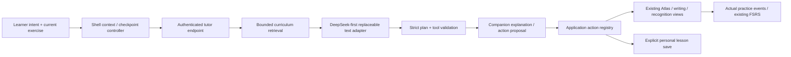

# Contextual assistant that operates ChineseOS

**Status: architecture proposal for review, 1 November 2026. Not an accepted ADR or implementation authorization.**

The assistant is a small companion to the screen the learner is already using. It can explain the selected word, show its verified family in Atlas, open the shared writing exercise, arrange existing learning components and propose a lesson from a conversation. It does not send the learner to a second chat product, replace the application shell or grant itself permission to save or grade anything.

This is the ChineseOS-owned proposal. [PRODUCT.md](PRODUCT.md) remains the product authority. The document defines the smallest integration and its later gates; it does not introduce a second product roadmap, scheduler or content master catalog. No runtime implementation, dependency installation, model call, new credential, migration or deployment is part of this documentation change. The current pause on further audio generation and hosting changes remains in effect.

## 1. Inspection baseline and relationship to PR 528

Inspected application source: **Sites v61, `12ba587c42be1eb5ebd3e9462a5323b57a9ea4f7`**, based on v60 `ba35ec333062bfe0c0714ab6e8e05be769676d99`. The source checkpoint is `/Users/gizmuf/Dev/Xcode/Chinese OS/_worktrees/chinese-os/qwen-comparison-release`. This proposal is authored in the isolated `assistant-architecture-docs` worktree, branch `codex/contextual-assistant-architecture`, from that exact base. All 32 existing `public/audio-comparison` files must survive later integration. GitHub's older main and the unmerged recognition PR are not substitutes for this published-source baseline.

External input is [PulsAI draft PR 528](https://github.com/gizmuf/pulsai/pull/528), inspected at `17ce46af240f003abff819f78e26887b001d1746`. At inspection it was open, draft and unmerged. Both documents are proposals, not adopted decisions:

- [Creative learning architecture](https://github.com/gizmuf/pulsai/blob/17ce46af240f003abff819f78e26887b001d1746/docs/reviews/2026-11-01-creative-learning-architecture.md).
- [Pro review request](https://github.com/gizmuf/pulsai/blob/17ce46af240f003abff819f78e26887b001d1746/docs/reviews/2026-11-01-creative-learning-pro-review.md). This is a request for review, not a completed Pro approval.

| PR 528 idea | ChineseOS decision proposed here |
| --- | --- |
| A complete lesson from conversation | Retain, but put the assistant alongside the active exercise. A conversation is an input to ChineseOS operations, not a separate destination. |
| A shared, rich scene interchange format | Start with a smaller ChineseOS UI plan over its existing components. Do not adopt the full video timeline/asset/renderer contract just to open Atlas or writing. A pure scene interchange adapter may be evaluated later. |
| Separate dialogue, scene state and learning evidence | Retain explicitly. Application reducers and existing practice rules own state and assessment; the model supplies bounded proposals. |
| ChineseOS source observations at Sites v56 | Superseded for this proposal by the inspected v61 paths below, including shared writing, lesson 09 and actual API allowlists. |
| Two products with separate authority and data | Retain. ChineseOS does not read PulsAI Brand data, credentials, jobs, databases or approval state. No PulsAI backend access is needed to retrieve Chinese-learning material. |
| 2D tutor, voice, renderers and movie export | Later, separately reviewed capabilities. No voice, 3D, movie export, runtime installation or automatic code-writing in the first stage. |

DeepSeek is the **first proposed text-model adapter**, as requested, while the application/tool/lesson contracts remain provider-independent. This is not a claim of API access, quota, chosen model version or benchmarked quality. Provider/library research is separate; this document does not adopt the candidate libraries in PR 528.

## 2. Actual code and integration seams

All line references in this table refer to the pinned v61 source, before this docs change. **Existing** means source-inspected; it does not claim a new assistant has been implemented or tested.

| Area | Existing source | Consequence for the proposed integration |
| --- | --- | --- |
| One application shell | [study-app.tsx:81](../app/study-app.tsx#L81), [navigation:406](../app/study-app.tsx#L406), [providers:516](../app/study-app.tsx#L516) | Mount one shell-owned companion panel within the existing providers. Reuse locale, owner, notifications and selected-item context. No second sidebar/auth shell. |
| Current navigation is not a safe generic tool | [openPractice:337](../app/study-app.tsx#L337), [startReview:349](../app/study-app.tsx#L349), [Atlas return:392](../app/study-app.tsx#L392) | These functions reset session/view/URL state. Wrap them behind a checkpoint-aware controller; do not expose them directly to model calls. |
| Atlas routes and IDs | [CloudRoute:7](../app/atlas-cloud-route.ts#L7), [parser:15](../app/atlas-cloud-route.ts#L15), [href:27](../app/atlas-cloud-route.ts#L27), [navigation:94](../app/atlas-cloud.tsx#L94) | Resolve known word/character/component IDs, then construct routes with existing helpers. Models do not supply raw URLs or manipulate history. |
| Relation semantics | [cloudRelation:16](../app/atlas-cloud-connections.ts#L16), [extended family:34](../app/atlas-cloud-extended.ts#L34) | Preserve meaning/sound/shape distinctions. The fallback shape relation is not proof of historical etymology or a phonetic/semantic relationship. |
| Shared writing | [SharedWriting:20](../app/shared-writing.tsx#L20), [supported scoring:43](../app/shared-writing.tsx#L43), [four modes:173](../app/writing-practice.tsx#L173) | Reuse Watch/Trace/Copy/Recall and existing ink storage. SharedWriting currently starts at Watch; an initial-mode/controlled-mode wrapper would be a proposed change, not an existing API. Contextual Recall remains assisted. |
| Contextual lookup | [StudyLookupProvider:33](../app/study-lookup.tsx#L33), [explore callback:58](../app/study-lookup.tsx#L58) | Reuse definitions/examples, but the present Explore callback opens a new tab. The new companion needs same-shell navigation through its controller instead. |
| Curriculum and retrieval | [Item:3](../app/content.ts#L3), [1,020 items:108](../app/content.ts#L108), [dictionary:23](../app/study-lookup-model.ts#L23), [examples:29](../app/study-examples.ts#L29), [lesson 09:6](../app/lesson09-data.ts#L6) | Build a bounded adapter over existing data. Preserve IDs, senses, pinyin, source examples and audio references; do not maintain another vocabulary catalog. |
| Identity | [AuthShell:94](../app/auth-shell.tsx#L94), [owner-keyed shell:136](../app/auth-shell.tsx#L136), [request-user:5](../app/request-user.ts#L5), [authenticatedFetch:34](../app/auth-client.ts#L34) | Use the current Sites/Firebase identity path and owner checks. Supplied invalid Firebase tokens do not fall back to a different Sites account. Guests remain separate. |
| Storage/runtime | [hosting manifest](../.openai/hosting.json), [D1:1](../db/index.ts#L1), [Worker:1](../build/sites-worker.ts#L1), [event tables:8](../db/schema.ts#L8) | Existing HTTP Worker + D1 `DB`; no R2 binding. Current tables store learning events, not personal lessons or conversations. |
| No deployed model backend | [connector helper:5](../lib/connectors.ts#L5), [package dependencies](../package.json) | The connector helper is starter infrastructure with no application invocation found. No chat route or text-model integration was found. Generated runtime metadata has no Vectorize/services and empty local vars; production secrets were not inspected. |
| Owner-scoped local state | [local-store:2](../app/local-store.ts#L2), [sync:227](../app/study-app.tsx#L227), [guarded course session:32](../app/course-persistence.ts#L32) | Reuse owner-separated IndexedDB and the guarded-session pattern for new state. Add explicit abort/identity fences; do not assume a remount alone cancels a provider or late callback. |
| Existing FSRS | [isReview:56](../app/learning.ts#L56), [event replay:63](../app/learning.ts#L63), [queue pool:80](../app/learning.ts#L80), [rating commit:117](../app/recognition-review.tsx#L117) | Reuse the scheduler and durable event UUIDs. A conversation, scene completion or saved lesson creates no grade. |
| Runtime-content restrictions | [item allowlist:9](../app/event-schema.ts#L9), [course enum/allowlists:35](../app/course-learning.ts#L35), [course review registry](../app/course-review-model.ts) | Arbitrary custom IDs cannot enter current APIs/queues. A model-created prefix does not bypass validation. |
| Mixed-level selection | [level filtering:117](../app/study-app.tsx#L117) | A personal lesson spanning levels must use its explicit selected-ID pool and the corresponding owner notebook events, not only the active HSK filter. |

### Companion panel behavior

On desktop/tablet the panel occupies a small adjacent region; on a phone it becomes a collapsible sheet, with the exercise remaining the primary surface. It can show one explanation, a few source-backed examples or an action proposal beside the selected object. Do not automatically cover writing cells, capture Pencil events or replace the main exercise whenever a token arrives.

Back/Close return focus and scroll to the originating control. Keyboard navigation, labelled buttons, readable Hanzi, reduced motion and EN/FR/RU/TR interface behavior remain application responsibilities. Target at least 44 CSS-pixel touch controls and test phone/iPad layouts and keyboard resizing; these are acceptance targets, not completed hardware tests.

If the learner is writing or answering, an assistant response first appears inline. Navigating away either preserves a checkpoint or requires an explicit discard choice. Do not interrupt a stroke, erase an answer or invoke a new browser tab to satisfy “show me this family.”

## 3. Control plane: the model proposes, ChineseOS decides

Proposed flow:



The model never receives shell/Codex execution, arbitrary JavaScript/HTML, dynamic imports, React component source, SQL, environment access, browser cookies or credentials. No self-rewriting application, remote code execution or inferred tool permission is part of “generative UI.” It selects a validated declarative layout and registered tools. The renderer resolves component names to application-owned code; text is escaped, not inserted as arbitrary HTML. An unsupported schema version, node, tool, ID or property is rejected visibly without a best-effort execution fallback.

### One central action/tool registry

The following names are **proposed wrappers**, not callable functions that already exist. Each entry defines its input/output schema, capability class, owner/intent/revision checks, limits, idempotency and cancellation behavior. The server and client validate against the same versioned contract. A capability supplied in a model response cannot enlarge the registry.

| Proposed action | Class and permission | Existing seam / bounded behavior |
| --- | --- | --- |
| `curriculum.search` | Read; current turn's scoped retrieval | Canonical items/dictionary/examples. Return source IDs and bounded snippets, not the full corpus or notebook history. |
| `examples.show` | Read/display; same selected IDs | `studyExamples`, dictionary details. Label generated examples as draft; existing examples retain their source/audio identity. |
| `atlas.open` | Navigation; explicit current user intent or selected proposal | Resolve exact known IDs to CloudRoute; checkpoint first. No arbitrary URL/new tab. |
| `writing.open` | Navigation/practice setup; explicit user intent | SharedWriting/Writing wrappers. Preserve current draft; contextual practice is assisted even when its surface is Recall. |
| `review.open` | Navigation/practice setup; explicit selected vocabulary | Existing RecognitionReview and makeQueue, with a pinned explicit pool. Guidance cannot silently create an independent grade. |
| `scene.propose` | Draft proposal, no persistence | Strict UI-plan nodes referring to registered components and resolved content. Rendering an explanation creates no learning event. |
| `lesson.propose` | Draft proposal, no persistence | Validated lesson schema; known IDs resolved server-side, new vocabulary retained as draft candidates. |
| `sources.propose` | Read/proposal only; optional later backend retrieval | Server-controlled source registry and provenance. No model-chosen credentialed endpoint or arbitrary URL fetch. |
| `lesson.save` | Persistent write; explicit save intent bound to the previewed revision | Owner, schema/content revision, content hash and save-request UUID. Same UUID/payload replays one save; changed payload conflicts. |
| `practice.add` | Persistent collection membership; explicit selected IDs | Persist the chosen lesson/collection membership once. No synthetic learning event, grade or “mastered” flag. |
| `content.activate` | Persistent write; explicit validated-content activation intent | Only a validated owner-owned revision may become active. The model cannot activate its draft or change published curriculum. |
| `practice.rate` | **Not a model tool** | Existing trusted exercise controls create events only after actual practice. Never expose a general “award progress” function. |

Read/navigation tools do not require a repetitive confirmation for every action already explicitly requested. Persistent writes need a concrete current intent: “save this lesson” or selection plus “add these words,” tied to the current preview/version. A model asking its own tool to confirm is not that intent. If a navigation would discard unsaved work, the application asks a focused discard/preserve question instead of assuming the earlier navigation request authorized data loss.

### Checkpoints, races and state ownership

- Keep one shell-owned context controller and per-owner workspace/checkpoint store. A checkpoint references the current route, exercise/run UUID, selected IDs, queue, reveal stage, scroll/focus target and durable draft revision; raw ink stays in the existing local exercise store.
- Existing `openPractice`/`changeView` are adapters behind that controller, not ready-made safe tools. Before a switch, flush the current draft or keep its component mounted. A blocked flush leaves the exercise visible and allows retry; it does not reset state first.
- Each turn carries `turnId`, `ownerEpoch`, `contextRevision`, `exerciseRunId` and cancellation state. Every streamed chunk, action, save acknowledgment and delayed callback checks the current epoch/revision. Ignore stale results and fence writes; do not merely hide them in the UI.
- Cancel/Close aborts active model/network work where supported and invalidates queued actions. An accepted provider call may still finish or incur usage; an application cancellation is not a billing reversal. Preserve already committed practice events.
- History entries represent application navigation/checkpoint references. Back/Forward restore the existing exercise and filters instead of rebuilding a new queue. Reload resumes validated local state; cloud sync must not overwrite a newer local draft.
- A double click/retry reuses the same operation UUID. Owner change disposes the old session, aborts transport and prevents guest/user or user/user cross-writes. Never silently import a guest transcript into a signed-in account.

## 4. Context, declarative scene and lesson contracts

These abbreviated TypeScript/JSON contracts specify the proposal. They are documentation examples, not installed runtime code or claims that validators already exist. Unknown fields are rejected; no arbitrary free-form component props, executable expressions or URLs are accepted.

```ts
type ContextEnvelopeV1 = {
  schemaVersion: 1;
  turnId: string;             // UUID, generated by the trusted application
  ownerEpoch: number;         // local fence; not a provider-visible user identifier
  contextRevision: number;
  exerciseRunId?: string;
  view: 'today' | 'lessons' | 'atlas' | 'course' | 'practice' | 'reviews' | 'progress' | 'grammar';
  selected: { itemIds: string[]; characterIds: string[]; componentIds: string[] };
  locale: 'en' | 'fr' | 'ru' | 'tr';
  studyScope: { level: 'hsk1' | 'hsk2' | 'hsk3' | 'bonus'; mixedItemIds?: string[] };
  exercise: { skill?: 'meaning' | 'writing' | 'listening'; phase?: string;
              dirty: boolean; checkpointRevision?: number; helpVisible: boolean };
  audience: 'guest-local' | 'signed-in-private';
  permittedActions: string[]; // computed from registry + current server policy
  dueSummary?: { meaning: number; writing: number }; // only when needed
};
```

The browser's claimed owner is not authentication. Server ownership comes from `getRequestUser`. Keep the authoritative owner ID and permission records out of provider prompts; forward only the minimum pedagogical subset of the envelope, selected source snippets and bounded recent conversation. Do not send tokens, email, raw handwriting, full learning events, exact storage locations or unrelated diary/history. The model's response is untrusted regardless of the provider.

```ts
type UiPlanV1 = {
  schemaVersion: 1; planId: string; revision: number;
  basedOnContextRevision: number; sourceRefs: string[];
  placement: 'companion' | 'inline-explanation' | 'proposed-main-view';
  layout: 'stack' | 'two-column';
  nodes: Array<
    | { id: string; kind: 'explanation'; text: string; sourceRefs: string[] }
    | { id: string; kind: 'examples'; itemIds: string[]; exampleIds: string[] }
    | { id: string; kind: 'atlas-focus'; itemId: string; character: string;
        relation: 'meaning' | 'sound' | 'shape' | 'all' }
    | { id: string; kind: 'writing-request'; itemId: string;
        mode: 'watch' | 'trace' | 'copy' | 'recall' }
    | { id: string; kind: 'vocabulary-selection'; itemIds: string[] }
    | { id: string; kind: 'lesson-preview'; lessonDraftId: string; contentRevision: number }
  >;
  actions: NavigationProposalV1[];
};
type NavigationProposalV1 =
  | { actionId: string; tool: 'atlas.open'; args: { itemId: string; character: string;
      relation: 'meaning' | 'sound' | 'shape' | 'all' } }
  | { actionId: string; tool: 'writing.open'; args: { itemId: string;
      mode: 'watch' | 'trace' | 'copy' | 'recall' } }
  | { actionId: string; tool: 'review.open'; args: { itemIds: string[];
      skill: 'meaning' | 'writing' | 'listening' } }
  | { actionId: string; tool: 'examples.show'; args: { itemId: string; exampleIds: string[] } };

// A separate user-triggered save request, never an executable model-plan action:
type SaveLessonSelectionV1 = {
  schemaVersion: 1; requestId: string; lessonDraftId: string;
  expectedRevision: number; expectedContentHash: string; selectedItemIds: string[];
}; // Authenticated owner is resolved on the server, not supplied by this payload.
```

Persistent registry entries are intentionally absent from the model-executable action union. The model may propose a save/enrollment control, but only the explicit user-triggered write endpoint can invoke that registry handler after ownership and preview revision checks. Read-tool inputs and draft-proposal inputs likewise have their own strict schemas.

Only fully parsed/validated plans can be applied. Streaming partial prose is permitted; partial JSON, a provisional save button or a half-rendered action plan is not executable. Cross-node IDs, content references, layout bounds and action permissions must validate as one plan. Existing views retain their own state and accessibility; the plan is not a second renderer implementation of their internals.

```ts
type PersonalLessonV1 = {
  schemaVersion: 1; lessonId: string; revision: number; contentHash: string;
  title: string; locale: 'en' | 'fr' | 'ru' | 'tr'; objectives: string[];
  knownVocabulary: Array<{ itemId: string; sourceRevision: string }>;
  proposedVocabulary: Array<{ candidateId: string; hanzi: string; pinyin: string;
    meaning: string; sourceRefs: string[]; validation: 'draft' | 'review-needed' | 'validated' }>;
  examples: Array<{ exampleId: string; text: string; pinyin: string; translation: string;
    sourceRefs: string[]; origin: 'authored' | 'generated'; audioRef?: string }>;
  scenePlans: UiPlanV1[];
  provenance: { sourceRefs: string[]; generatedBy?: { adapter: string; modelVersion: string } };
  validation: { structural: boolean; linguistic: 'pending' | 'validated' | 'review-needed' };
};
```

Owner/visibility are server-side envelope fields, not model-editable lesson properties. Save-request UUID and expected revision accompany a write command. Revisions are immutable; updates use compare-and-set against the expected revision, not in-place changes to material already used in review. A structurally valid draft is not automatically linguistically correct. Established, validated teaching primitives can pass automatic checks; ambiguous Mandarin, pinyin or semantic claims remain marked for targeted review. This does not impose a human approval ritual on every explanation.

### Worked example: my day → movement → Atlas → writing → flashcards

The following is a proposed fixture using real canonical vocabulary IDs verified in v61: 去/qù (`hsk1-167`), 来/lái (`hsk1-106`), 回/huí (`hsk1-081`), 家/jiā (`hsk1-086`) and 学校/xuéxiào (`hsk1-250`). The generated sentence is explicitly an illustrative draft, not an existing authored recording or a claim of a reviewed movement curriculum.

```json
{
  "schemaVersion": 1,
  "lessonId": "11111111-1111-4111-8111-111111111111",
  "revision": 1,
  "title": "My day: going to school and returning home",
  "locale": "en",
  "objectives": [
    "Describe a destination",
    "Distinguish going, coming and returning"
  ],
  "knownVocabulary": [
    {
      "itemId": "hsk1-167",
      "sourceRevision": "12ba587c42be1eb5ebd3e9462a5323b57a9ea4f7"
    },
    {
      "itemId": "hsk1-106",
      "sourceRevision": "12ba587c42be1eb5ebd3e9462a5323b57a9ea4f7"
    },
    {
      "itemId": "hsk1-081",
      "sourceRevision": "12ba587c42be1eb5ebd3e9462a5323b57a9ea4f7"
    },
    {
      "itemId": "hsk1-086",
      "sourceRevision": "12ba587c42be1eb5ebd3e9462a5323b57a9ea4f7"
    },
    {
      "itemId": "hsk1-250",
      "sourceRevision": "12ba587c42be1eb5ebd3e9462a5323b57a9ea4f7"
    }
  ],
  "proposedVocabulary": [],
  "examples": [
    {
      "exampleId": "draft-movement-1",
      "text": "我去学校，然后回家。",
      "pinyin": "Wǒ qù xuéxiào, ránhòu huí jiā.",
      "translation": "I go to school, then return home.",
      "sourceRefs": [
        "curriculum:hsk1-167@12ba587c42be1eb5ebd3e9462a5323b57a9ea4f7",
        "curriculum:hsk1-106@12ba587c42be1eb5ebd3e9462a5323b57a9ea4f7",
        "curriculum:hsk1-081@12ba587c42be1eb5ebd3e9462a5323b57a9ea4f7",
        "curriculum:hsk1-086@12ba587c42be1eb5ebd3e9462a5323b57a9ea4f7",
        "curriculum:hsk1-250@12ba587c42be1eb5ebd3e9462a5323b57a9ea4f7"
      ],
      "origin": "generated"
    }
  ],
  "scenePlans": [
    {
      "schemaVersion": 1,
      "planId": "22222222-2222-4222-8222-222222222222",
      "revision": 1,
      "basedOnContextRevision": 7,
      "sourceRefs": [
        "curriculum:hsk1-167@12ba587c42be1eb5ebd3e9462a5323b57a9ea4f7",
        "curriculum:hsk1-106@12ba587c42be1eb5ebd3e9462a5323b57a9ea4f7",
        "curriculum:hsk1-081@12ba587c42be1eb5ebd3e9462a5323b57a9ea4f7",
        "curriculum:hsk1-086@12ba587c42be1eb5ebd3e9462a5323b57a9ea4f7",
        "curriculum:hsk1-250@12ba587c42be1eb5ebd3e9462a5323b57a9ea4f7"
      ],
      "placement": "companion",
      "layout": "stack",
      "nodes": [
        {
          "id": "explain-going",
          "kind": "explanation",
          "text": "Choose words for going to school and returning home. The new sentence remains a draft for language review.",
          "sourceRefs": [
            "curriculum:hsk1-167@12ba587c42be1eb5ebd3e9462a5323b57a9ea4f7",
            "curriculum:hsk1-106@12ba587c42be1eb5ebd3e9462a5323b57a9ea4f7",
            "curriculum:hsk1-081@12ba587c42be1eb5ebd3e9462a5323b57a9ea4f7",
            "curriculum:hsk1-086@12ba587c42be1eb5ebd3e9462a5323b57a9ea4f7",
            "curriculum:hsk1-250@12ba587c42be1eb5ebd3e9462a5323b57a9ea4f7"
          ]
        },
        {
          "id": "family-return",
          "kind": "atlas-focus",
          "itemId": "hsk1-081",
          "character": "回",
          "relation": "all"
        },
        {
          "id": "write-return",
          "kind": "writing-request",
          "itemId": "hsk1-081",
          "mode": "recall"
        },
        {
          "id": "choose-practice",
          "kind": "vocabulary-selection",
          "itemIds": [
            "hsk1-167",
            "hsk1-081",
            "hsk1-086",
            "hsk1-250"
          ]
        }
      ],
      "actions": [
        {
          "actionId": "show-return-family",
          "tool": "atlas.open",
          "args": {
            "itemId": "hsk1-081",
            "character": "回",
            "relation": "all"
          }
        },
        {
          "actionId": "write-return",
          "tool": "writing.open",
          "args": {
            "itemId": "hsk1-081",
            "mode": "recall"
          }
        }
      ]
    }
  ],
  "provenance": {
    "sourceRefs": [
      "curriculum:hsk1-167@12ba587c42be1eb5ebd3e9462a5323b57a9ea4f7",
      "curriculum:hsk1-106@12ba587c42be1eb5ebd3e9462a5323b57a9ea4f7",
      "curriculum:hsk1-081@12ba587c42be1eb5ebd3e9462a5323b57a9ea4f7",
      "curriculum:hsk1-086@12ba587c42be1eb5ebd3e9462a5323b57a9ea4f7",
      "curriculum:hsk1-250@12ba587c42be1eb5ebd3e9462a5323b57a9ea4f7"
    ],
    "generatedBy": {
      "adapter": "local-fixture",
      "modelVersion": "fixture-v1-no-provider-call"
    }
  },
  "validation": {
    "structural": true,
    "linguistic": "review-needed"
  },
  "contentHash": "f960e8ea14fe2d0ef2a001667b140f8ee37f55f56d2c422a4d930f5a0245f366"
}
```

This is a complete fixture for the proposed `PersonalLessonV1` and `UiPlanV1` shapes, with local-fixture provenance and no provider call. `contentHash` is SHA-256 of the UTF-8, recursively key-sorted, compact JSON lesson with `contentHash` omitted; the future implementation must pin one cross-language canonical serialization, not assume arbitrary serializer output is identical. Source references support the selected vocabulary, **not** independent validation of the newly generated sentence. Its draft status applies until linguistic validation; it has no audio reference. The two navigation actions are proposals awaiting the matching learner intent; they do not run together automatically. A later Save command carries its own client-generated save-request UUID and expected lesson revision/hash, outside model-controlled lesson content.

1. While an existing writing exercise is open, the learner says: “Today I left home, went to school and came back. Teach me how to describe it.” The companion retrieves only the relevant curriculum and proposes the five known words and a lesson preview. If the writing cell is dirty, it stays intact and the explanation remains beside it.
2. “Show the family of 回” authorizes `atlas.open` for that exact known item/character. The trusted resolver obtains actual available component/family IDs from current data. If no verified family relation is available, show that limit; do not invent a phonetic family or etymology. Checkpoint the writing exercise before changing the main view.
3. “How do I use it?” displays existing sourced examples in the current context. Generated additions remain draft-labelled and do not acquire a fabricated audio ID.
4. “I want to write it from memory” opens the **same** Watch/Trace/Copy/Recall machinery. Because the tutor just showed the answer, this contextual Recall remains supported practice. Back returns to the original exercise checkpoint with ink and answers unchanged. No new writing module is introduced.
5. The learner chooses 去、回、家、学校 and presses “Save lesson and add selected words.” Save the previewed revision and membership once using owner + save-request UUID. A repeated click/reload produces one lesson, not two. Merely recommending the words did not save them.
6. “Practise these words” opens a pinned queue of those canonical IDs. A guided round remains assisted. A later real independent review uses the existing reveal/rating flow and existing FSRS event IDs; the lesson refers to the same global word/skill history rather than creating duplicate cards for each view.

For 进来/进去/出来/出去, the later teaching scene must explicitly model actor, doorway/inside-outside boundary, movement path and the **speaker/deictic reference anchor**. Camera position is presentation only. Ask for an ambiguous reference point or state the selected speaker location. 上楼/下楼 and going to school require their own valid constructions; do not reduce movement teaching to four interchangeable arrows. A stage-1 text explanation can use reviewed examples without claiming an implemented spatial simulator.

## 5. Content, learning and persistence boundaries

### Reuse first; extend the registry deliberately

The retrieval adapter searches the existing 1,020 Items, authored course/lesson content, dictionary and examples. It returns exact source revision, sense/context, pinyin and available complete-word/sentence audio IDs. The text-keyed dictionary and longest-match tokenization are candidate lookup aids, not authoritative assessment identities or proof of correct segmentation/polyphone readings. Do not rewrite canonical pinyin from an unverified model response.

“Expand this family with HSK4/5” produces a **sourced extension proposal**, not a claim that ChineseOS already has a complete HSK4/5 curriculum. Identify the requested syllabus/edition, rights and actual coverage. Distinguish modern graphic decomposition from established semantic/phonetic relations and historical etymology. Unknown relations stay unknown; a visually similar component is not linguistic evidence. Do not relabel unverified entries as reviewed curriculum.

Entirely new vocabulary needs an owner-scoped content registry: stable custom UUID, immutable content revision/hash, provenance and `draft → review-needed/validated → active` lifecycle, with superseded revisions retained for historical evidence. Never reassign an existing canonical ID. “Active” means usable content, not learned/mastered. A review references a resolvable historical content revision; editing pinyin later must not silently change what a previous review tested.

The runtime resolver must be integrated across server event validation, client selected-item fallback, recognition draft restoration, queues/Today/progress filters, backup/export and personal lesson reload. Current item/course allowlists remain effective until those owner-scoped resolvers exist. Accepting arbitrary strings beginning with `custom:` is not a registry. Generated activities also need validated per-owner lesson/activity membership instead of appending guesses to the static course enum.

### Three separate data classes

| Data | Retention and authority | Learning effect |
| --- | --- | --- |
| Private conversation / context | Transient by default; optional owner-local draft; explicit retention choice for any server history | None |
| Curriculum / personal lesson revision | Canonical authored content or explicitly saved, validated owner-owned material | Available to study; no automatic mastery |
| Learning evidence | Actual exercise events with original UUID, owner, assisted status and assessment semantics | Existing scheduler decides eligibility and next review |

Use a personal-lesson collection to store chosen vocabulary membership; avoid a second copy of known vocabulary or a parallel FSRS store. Add minimal owner-scoped D1 lesson/content tables and IndexedDB stores only when their stage is approved. The current event primary key `(userId,id)` deduplicates uploads, not lesson saves: a save needs unique `(owner,saveRequestId)`, expected content revision/hash and a stable response on replay. Same request UUID with different payload returns a conflict. Offline saves remain pending until acknowledged; an acknowledgment must not erase a newer local edit.

Known-ID-only lesson practice can keep the current event schema and scheduler. Mixed-level lessons use their explicit membership and matching owner notebook history, not the active-level filtered event subset. Owner changes, guest storage, reload and backup/import need the same isolation rules as existing practice. Do not silently migrate guest content or publish a private day narrative.

No FSRS credit arises from chat, generated praise, reading an explanation, scene transitions, lesson save, vocabulary enrollment or “I know this.” `practice.rate` remains outside the model registry. Preserve v60 recognition semantics: the normal Hanzi → pinyin → meaning reveal is standard self-checking after an attempt and does not by itself make that review assisted; keep “Rate what you remembered before revealing.” Premature help from the assistant, lookup or audio, according to the active exercise rules, must durably mark that attempt assisted **before** exposing the answer; streaming/explanation nodes cannot bypass answer hiding or later remove that flag. Contextual writing keeps its existing assisted semantics. Pronunciation/handwriting grading is not inferred from text generation, stroke display or future speech transcription.

## 6. Server, provider, retrieval and resource policy

Proposed `POST /api/tutor` uses `getRequestUser`, existing owner-aware authenticatedFetch, same-origin checks and strict bounded schemas. First backend MVP requires sign-in; guests retain local practice and fixtures, not an unmetered anonymous paid model endpoint. ChatGPT subscription access is not a server API credential. The existing Mac Keychain TTS credential is restricted to TTS and must not be repurposed or shipped to Sites/client code.

Use a small `TextModelAdapter` interface with a configured DeepSeek implementation first and a local fixture implementation for stage 1. Adapter/model/version/endpoint and policy are server-selected. The browser/model cannot override endpoint, API key, region, permission scope or budget. No particular SDK is adopted by this document.

For streaming, use authenticated POST fetch + a typed event stream; native EventSource cannot carry the current Firebase Bearer and owner headers. Events contain a turn UUID, monotonically increasing sequence number and revision fence. Partial text may display; complete tool/scene proposals wait for validation. Check error/status before reading the body. Tie client AbortController, server request cancellation and provider abort together where supported; prove behavior rather than assuming cancellation saves usage.

Sites source currently has a Vinext HTTP Worker and D1 `DB`; it has no application chat endpoint or proven SSE integration. The installed Sites workflow documents 128 MB per isolate and HTTP-based external connections, not raw TCP or a persistent background process. Proxy buffering, stream headers, auth behavior, provider timeout, abort propagation and mobile suspend/reconnect remain **platform acceptance gates**. If streaming is unsupported, select a single bounded nonstreaming response before dispatch. Do not automatically submit a second provider call after an ambiguous streamed timeout just to obtain a fallback; reconcile the original request first.

### Optional internet retrieval, backend only

Internet retrieval is a later capability, not a browser permission for the model. Use a server-controlled source registry, validated search queries and fetch rules: HTTPS, explicit allowed origins, DNS/redirect checks, private-address blocking, no credential forwarding, strict size/type/time limits and citation extraction. A fetched page is untrusted data and cannot supply new system instructions, tool grants, save requests or requests to read private files. The model never receives a general fetch-any-URL or credential tool.

Store source URL/identifier, retrieval date, quoted span/locator, license/rights note and content hash with an extension draft. Sources must actually support the associated relation/example. Do not silently copy whole copyrighted courses or infer media rights from code licenses. Chinese-learning sources require no PulsAI account or brand-data retrieval. No arbitrary image/audio URL in a UI plan; later assets must resolve through an approved asset registry and content limits.

### Proposed starting limits, not measurements or spend approval

These limits are a reviewable conservative starting policy. Stage 2 must reconcile them with the chosen provider and actual Sites behavior before dispatch.

| Boundary | Starting policy |
| --- | --- |
| Per turn | One provider request; zero automatic provider retries; maximum six proposed tool actions, no recursive autonomous agent loop |
| Writes | At most one explicit persistent operation per accepted user action; deduplicate by request UUID and revision |
| Context | At most eight recent messages, 16 KiB serialized pedagogical context and bounded retrieved snippets; never full notebook/diary dump |
| Retrieval | At most 18 candidate vocabulary records and eight examples per turn; at most five source citations; no external retrieval in stage 1 |
| Generated output | Maximum 4,096 output tokens; strict text/node/array bounds; maximum 12 scene nodes, nesting depth three |
| Concurrency | One active turn per owner workspace; cancel/fence the previous turn before accepting its replacement |
| Transport | Proposed 45-second overall deadline, to be validated against provider/proxy limits; on expiry show a resumable, honest status |
| Assets | No new media generation/download in stages 1–2; later external text fetch at most 256 KiB per document, with separately reviewed asset budgets |
| Spend | Server-enforced per-user and global request/token ceilings plus a kill switch before provider dispatch; explicit model/price/quota approval required |

An application allowance is not a provider-wide billing hard cap. The previously discussed USD10 Alibaba account ceiling does not authorize a new chat service, top-up or subscription and is not claimed enforced globally. No new key, billing activation or processing of private conversation by an unapproved provider is authorized here. Later setup must specify exact processor/model/region, secret location, data handling/retention, budget and allowed effects.

## 7. Staged plan and acceptance contract

These are **proposed future stages**, not an executable queue. Do not start the next stage because this document or a favorable review exists. Keep one source owner for integration.

| Stage | Smallest deliverable / likely future write-set | Exit acceptance and next gate |
| --- | --- | --- |
| 1. Existing views + local fixtures | Companion/controller, strict action/plan schemas, registry and wrappers around StudyApp, Atlas routes, lookup and shared writing. Local fixture responses only. | Same-shell explain → Atlas → writing → Back with unchanged dirty ink/answer/queue/reveal state. Unknown node/tool/ID rejected. No provider, persistence or FSRS side effects from proposals. Reviewer and learner evaluate this interaction before a model is connected. |
| 2. Authenticated text adapter | Proposed `app/api/tutor/route.ts`, server-only text adapter, owner/turn fences, bounded transport and cost guard. DeepSeek first if approved. | Verified authorized identity, no guest paid endpoint, cancellation/late-output isolation, typed stream or single-response fallback and measured request/token accounting. Requires specific provider/config/privacy/spend approval; no new voice. |
| 3. Selected known vocabulary + saved lessons | Proposed personal-lesson schema, owner-scoped D1 migration/API and IndexedDB pending store; integrate personal lessons into existing My lessons and explicit practice pools. | Preview/select/save/reload across devices; double-click/retry creates one lesson; offline pending survives; mixed-level IDs use shared existing FSRS only after real practice. No automatic grades on save or chat. |
| 4. Validated custom registry + sourced extensions | Runtime owner-scoped vocabulary/activity resolver, immutable content revisions and all allowlist/queue/Today/export adapters; optional backend source retrieval. | New content remains draft until required validation; cross-owner and unsupported IDs rejected. Sources/license/pinyin/relations checked. Existing canonical IDs and historic reviews unchanged. No claim of complete HSK4/5 coverage. |
| 5. Adaptive scenes / voice later | Evaluate a pure scene-contract adapter and reviewed movement primitives. Voice needs separately approved processor/permission/retention/cost/device work. | Deictic-anchor correctness, accessibility, real iPad/mobile/network and suspend/resume evidence; text/tap fallback preserves progress. Movie export, 3D and richer renderer choices remain separate decisions. Current audio pause stays intact until explicitly lifted. |

Recommended stage-1 responsibilities are small and separate: `assistant-panel`, `assistant-controller`, `assistant-contract`, `assistant-actions` and a fixture module, with narrow adapters in existing components. These are **proposed file responsibilities**, not current function names. Stage 1 changes no database schema, provider configuration, dependency/runtime installation or app source through generated code. No paid voice, 3D, export, auto-coding, arbitrary renderer plug-in, second FSRS or PulsAI integration.

### Required test matrix for later implementation

No tests in this matrix were executed by this documentation task. Pin fixtures and expected outcomes before implementing; run focused tests as each stage changes its boundary.

| Case | Required observable outcome |
| --- | --- |
| Atlas / examples / writing intent | Correct existing IDs/components, same shell, source-backed examples; no new browser tab or unrelated selection. |
| Dirty ink or unfinished answer | Companion explanation does not reset it. Navigation preserves/restores the checkpoint; failed save leaves the original visible. Discard requires explicit choice. |
| Back / Forward / Close / reload | Restore route/filter/scroll/focus, queue identity, reveal stage and ink; do not regenerate a new assessment or duplicate history entry. |
| Shared writing | All four existing modes remain available; contextual Recall remains assisted and never becomes recognition credit. |
| Cancel / rapid replacement / timeout | Previous transport is aborted where supported; stale chunks, scene actions and save callbacks cannot modify the current epoch/revision. Unknown provider completion is not silently retried. |
| Account change / guest / two accounts | No old-owner request/result/save reaches the new notebook. Guest and signed-in drafts stay separate; API rejects mismatched owner or invalid token without fallback. |
| Unknown schema/node/tool/ID/property | Strict rejection before rendering or tool dispatch; no arbitrary JavaScript/HTML/URL/import execution. |
| Model/source prompt injection | Requests for secrets, shell commands, arbitrary fetches, permissions or unrequested saves are treated as untrusted content; zero such effects. |
| Read/navigation-only action | No persistent collection/content/learning-event write and no FSRS advancement. |
| Conversation / generation / “I know this” / lesson save | Zero new grade/mastery events. Premature assistance follows the active exercise rules and stays assisted. |
| Standard reveal versus premature assistant hint | Normal three-stage recognition reveal remains unassisted self-checking, with rating based on memory before reveal. Assistant/lookup/audio help that exposes the active answer early persists assisted before display and cannot be reverted by later chunks, navigation or retry. |
| Real independent review | Existing original event UUID/rating semantics and scheduler result preserved; no second scheduler or per-view duplicate card identity. |
| Double click / delivery replay / changed payload | One save/membership per operation UUID; same result on replay; conflicting payload/revision rejected. |
| Offline save / online sync / late acknowledgment | Pending draft/selection survives reload, sync is idempotent and cannot overwrite a newer local revision. |
| Mixed-level lesson / current filter | All explicitly selected IDs remain in the lesson/queue; correct shared history used despite active HSK filter. |
| Unsupported/new vocabulary | No static-allowlist bypass, silent first-item fallback or lost custom references. Historical content revision remains resolvable. |
| Streaming / fallback / mobile suspend | Authenticated events stay ordered and bounded; no incomplete executable plan; fallback does not duplicate a possibly accepted provider request; resume is honest. |
| Mobile/iPad / accessibility | No horizontal overflow at representative phone/tablet widths; keyboard/focus return, screen-reader labels, reduced motion and Pencil canvas priority work. Physical iPad results are separate from viewport/simulated input. |
| Family/HSK extension quality | Meaning/sound/shape and uncertain etymology correctly labelled; sourced coverage/edition shown; no invented HSK4/5 completeness. |
| Movement scene | Speaker/reference anchor, inside/outside transition and path determine directional language; changing the camera alone cannot change the correct answer. |
| Resource/cost/privacy limits | Oversized context/output/nodes/tools rejected, concurrency fenced, request/token caps and kill switch effective; no hidden transcript retention or unsupported account-wide billing-cap claim. |
| Regression / release | Original lessons/PDFs/progress IDs and all 32 v61 audio-comparison assets preserved. Exact source/checks/publication evidence is required for any later authorized release. |

## 8. Ownership and next review

The next implementation owner should be the existing ChineseOS source owner for this task, after review of the stage-1 contract and an explicit implementation instruction. One branch/worktree owns integration. SituationLab may later consume the same validated scene/action contract; it must not create another learning-event or FSRS store. No new agent, model-routing change or cross-product owner is implied.

Review now: companion interaction and preservation rules; registry/scene schema boundaries; whether known-ID saved lessons are a useful first persistence milestone; specific requirements for entirely new vocabulary. Then, if authorized, implement **stage 1 only** with local fixtures and its acceptance tests. Provider access, runtime secrets, migrations, paid processing, audio and deployment remain later explicit gates.

The practical result should feel simple: “show this family,” “help me write,” or “teach me from my day” changes the relevant part of ChineseOS while preserving the learner's work. The complexity belongs in the validated controller and existing application components, not in a second chat interface or model-generated executable code.

## Stage 1 implementation

The additive `?study=studio` workspace uses the existing shell, owner notebook, Cloud Atlas, shared Watch/Trace/Copy/Recall writer, authored examples and RecognitionReview. Its sidebar is collapsed only within StudyStudio; the companion opens on demand, including at phone widths. Existing Atlas Lab 01 links (`?atlas=1&studio=1`) retain their meaning.

`app/study-studio-model.ts` defines the finite typed tools, exact example-command fixtures and versioned per-owner checkpoint. The checkpoint stores canonical item IDs, selected vocabulary, pinned review UUID/queue, writing mode, Atlas query and bounded Back history. Ink and reveal stages remain in the existing exercise drafts. Transactional revision/lease checks reject stale-tab writes; a failed workspace write leaves its previous visible destination intact. No database schema or scheduler was added.

Selected-word rounds are explicitly extra practice: RecognitionReview durably stores `practice: true` before displaying the round, and its existing events stay assisted. Contextual Recall likewise uses SharedWriting's existing assisted-writing rule. Ordinary independent review, reveal and event UUID semantics remain unchanged. Atlas quizzes pause external companion commands. There is no provider, arbitrary code execution, generated curriculum, TTS generation or live AI in this stage.

Validation: the focused workspace tests cover allowlisted inputs, action idempotency, Back, reload/checkpoint restore, owner separation, stale-tab rejection, mounted ink, supported queues and assessment navigation fences. Existing SharedWriting/RecognitionReview regressions cover real mode/reveal/rating persistence. Browser acceptance covers mouse ink and Back/reload restoration, flashcard reveal restoration, companion open/close, and responsive viewports (390px phone, 1024px iPad size, 1280px laptop); these are browser viewport checks, not physical iPad/Pencil acceptance.

## 4 November follow-up

Current context/voice/composition and billing proposal: [ASSISTANT_NEXT_STEP.md](ASSISTANT_NEXT_STEP.md). Live model integration remains a proposal; the shipped StudyStudio controller still uses fixtures.
